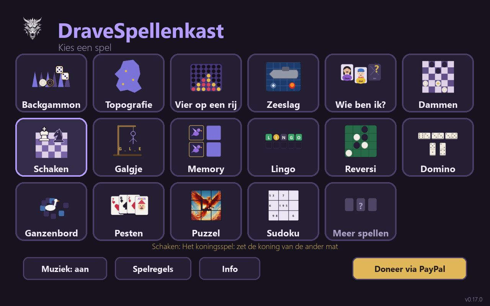
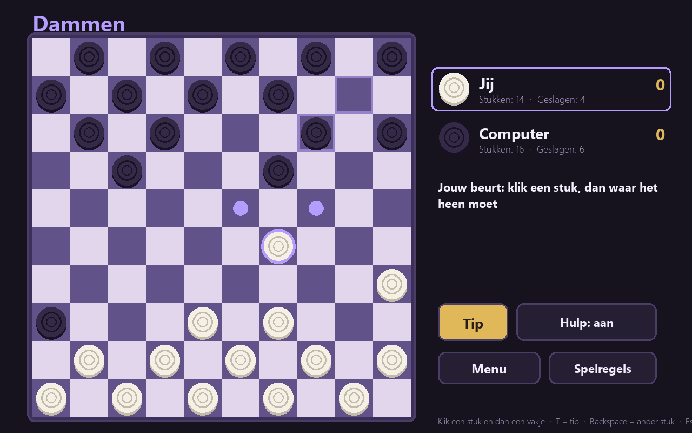
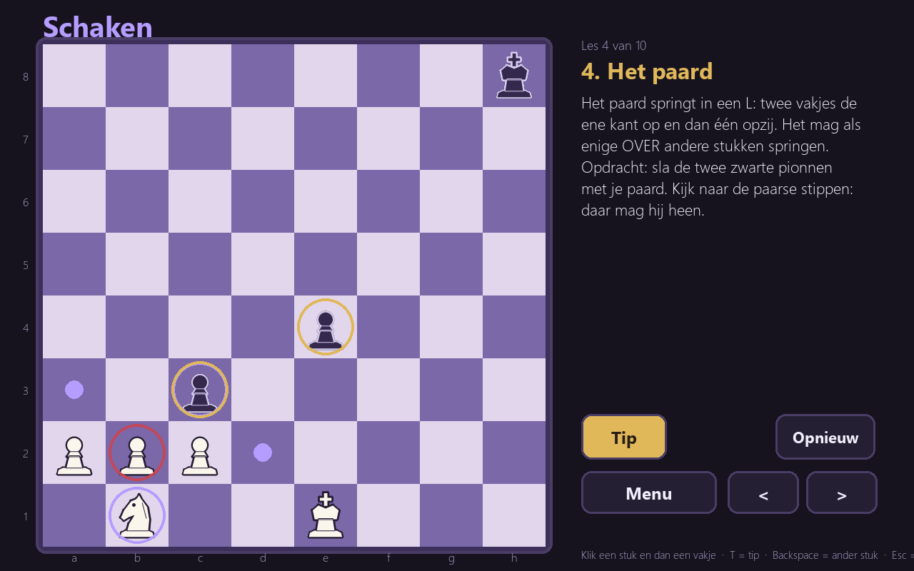
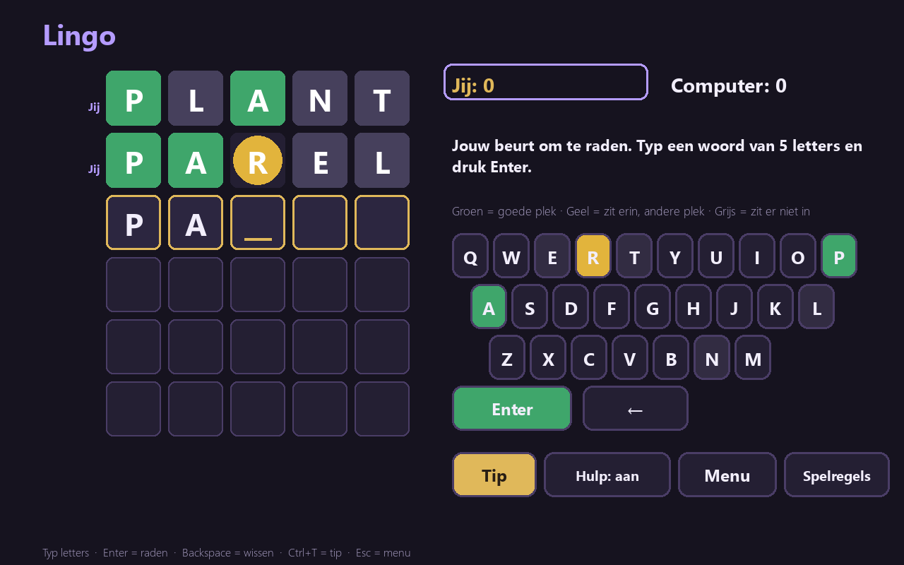
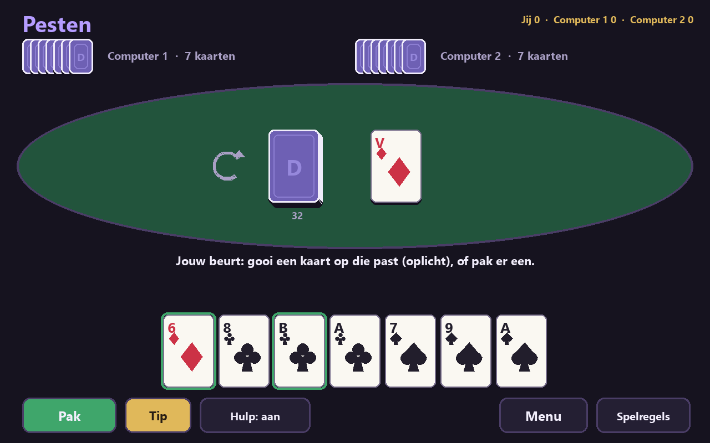
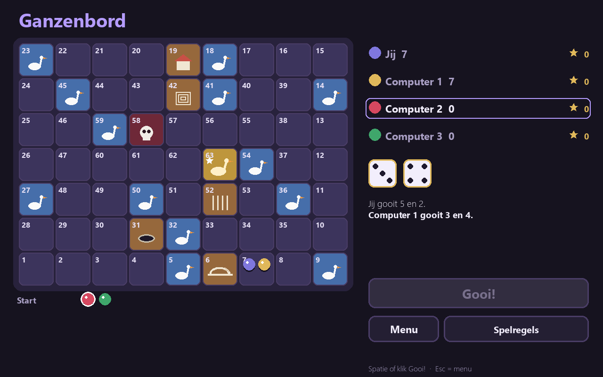
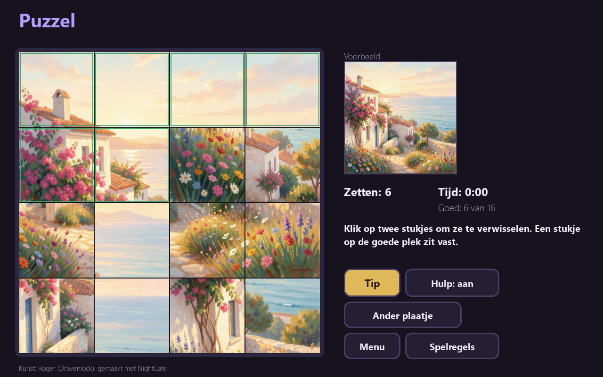
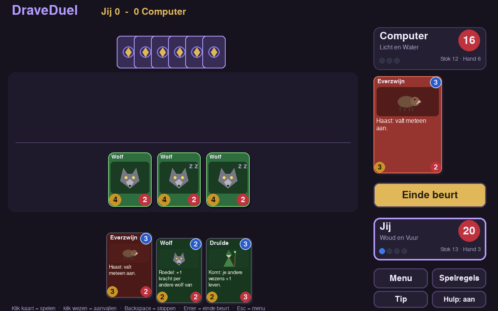

# DraveSpellenkast

**18 spellen in één kast.** Tegen de computer (makkelijk, normaal of moeilijk) of **online tegen elkaar**, ieder op zijn eigen pc. Gratis, zonder reclame en zonder account.

## 🎬 Uitlegvideo

[▶ Bekijk de uitlegvideo](https://dravenlock.nl/video/DraveSpellenkast.mp4) (Nederlands).

## De spellen

| | | |
|---|---|---|
| **Backgammon** – ook samen op één pc | **Topografie** – waar ligt het? Met de helikopter, net als op de C64 | **Vier op een rij** |
| **Zeeslag** | **Wie ben ik?** | **Dammen** – het echte Hollandse bord, 10 bij 10 |
| **Schaken** – met **10 korte lessen** voor wie het nog nooit deed | **Galgje** | **Memory** – zelf getekende plaatjes |
| **Lingo** – net als op tv | **Reversi** | **Domino** |
| **Ganzenbord** – met de put, het doolhof en de dood | **Pesten** – alle pestkaarten | **Puzzel** – met de kunst van Roger |
| **Sudoku** – elke puzzel nieuw, altijd één oplossing | **DraveDuel** – kaartspel met wezens, spreuken en draken | |

Bij bijna elk spel: **Hulp aan/uit** (laat zien wat mag en waar gevaar zit) en een **Tip**-knop. De spelregels van het spel dat je speelt staan achter de knop **Spelregels**.

| Dammen | Schaakles | Lingo |
|---|---|---|
|  |  |  |
| **Pesten** | **Ganzenbord** | **Puzzel** |
|  |  |  |
| **DraveDuel** | | |
|  | | |

## 🌐 Online spelen

Kies bij een spel **Online: op twee pc's**. De een klikt **Nieuwe kamer maken** en krijgt een code van 6 tekens; de ander typt die code en klikt **Meedoen**. Verbinding weg? Hij verbindt vanzelf opnieuw en het bord klopt weer. De server bewaart alleen het spel zelf, niets over jou.

*Versie 0.18.0*

## ⬇️ Downloaden (Windows, geen Python nodig)

### [👉 Download DraveSpellenkast](https://github.com/mbrv4ever/DraveSpellenkast/releases/latest)

1. Download het **.zip**-bestand en pak het uit (rechtsklik → **Alles uitpakken...**).
2. Dubbelklik op **DraveSpellenkast.exe**.
3. Er zit een **snelgids** (pdf) bij met alle spelregels.

> Zie je een blauw scherm "Windows heeft uw pc beschermd"? Klik op **Meer informatie** → **Toch uitvoeren**.

## Vanaf de broncode

Installeer Python 3.10 – 3.12 en de pakketten uit `requirements.txt`, en start `main.py`. `Start-DraveSpellenkast.bat` doet dit voor je; `Build-DraveSpellenkast-EXE.bat` maakt de .exe. Elk spel is een eigen bestand (`dammen.py`, `schaken.py`, `lingo.py`, ...); `online.py` praat met de spelserver.

## Licentie

Vrije software onder de **GNU GPL v3.0** (zie [LICENSE](LICENSE)). Gemaakt door **Dravenlock** (Roger & Claudio). De plaatjes in `assets/kunst/` zijn kunst van Roger (gemaakt met NightCafe). Gratis; donaties welkom, nooit verplicht: [paypal.me/roger076](https://paypal.me/roger076). Vragen: service@dravenlock.nl

---

*English: 17 classic games in one cabinet (draughts, chess with lessons, Lingo, crazy eights, game of the goose, sudoku and more) against the computer or online against each other. Free, no ads, no account. The app follows your Windows language (Dutch or English).*
